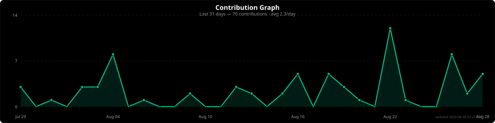

# Hi, I'm Luca

**20 y/o | Computer Science Student @ UniFACEF | Franca, SP - Brazil**

---

## About Me

I'm a 4th-semester Computer Science student focused on backend development with TypeScript.

I build REST APIs with authentication, authorization, database integration, secure password handling and deployment. I'm also exploring AI development and continuously improving my software engineering skills.

Currently seeking an internship where I can contribute to real-world projects and grow as a backend/software engineer.

Linux enthusiast — currently using CachyOS.

> _People you know and live with probably won't support you. Maybe people you don't know will._

---

## Featured Projects

| Project | What it does |
| --- | --- |
| [hub-epi](https://github.com/telinii/hub-epi) | EPI (safety gear) inventory control system — employees, equipment, deliveries, invoices, reports and PDF export. React + TypeScript + Supabase (PostgreSQL), with role-based access (admin vs. regular user), Zod validation, Vitest and PWA support. |
| [blog](https://github.com/telinii/blog) | RESTful Blog API with JWT authentication. |
| [maintenance-system](https://github.com/telinii/maintenance-system) | Maintenance tracking system for personal use. Deployed on Vercel. |

---

## Tech Stack

  
  
  
  
  
  
  
  
  
  
  
  
  
  
  
  

## Currently Learning

---

## My Activity

---

## Contact

---

